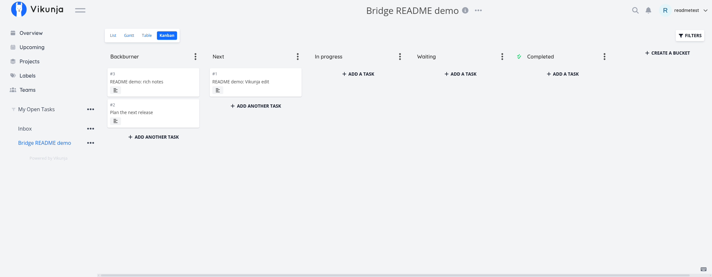

# Vikunja ↔ Google Tasks bridge

A self-hosted, two-way bridge between one Vikunja Kanban project and five dedicated
Google Tasks lists. It synchronizes task titles, plain-text notes, date-only due
dates and these statuses: **Backburner, Next, In progress, Waiting, Completed**.
The worker runs on your own Linux server; Google Tasks remains a Google service.
There is no dependency on an AI provider, model, hosted dashboard or public proxy.

## Behavior and limits

- Reads complete snapshots before making task changes. Field-level three-way
  merges hold conflicting edits for review instead of choosing a silent winner.
- Missing/deleted counterparts are held for review; no automatic deletion or
  recreation. Markers plus a persistent SQLite baseline recover interrupted creates.
- Five Google lists and one Vikunja project are selected explicitly. Google grants
  account-wide Tasks OAuth scope, even though this worker restricts itself to the
  configured lists. Review the consent screen before authorizing.
- Rich Vikunja notes survive unrelated field edits. Editing notes in Google replaces
  the Vikunja notes with escaped plain text. Attachments, comments, recurrence,
  reminders, subtasks and times of day are not synchronized.
- No conflict notification or alerting is included. Monitor the worker exit status
  and the private `links.issue` database column.

## Requirements

Server examples below target Debian 13 with Python 3.13, OpenSSL, `venv`, timezone
data, and systemd. Use an administrator account with `sudo`; if already root, omit
`sudo`. The worker needs private access to Vikunja and outbound HTTPS to Google.
The source uses Python's `zoneinfo` module. The reviewed Linux environment uses Python 3.13.5. The dependency lock records
that environment; other operating systems/Python versions need their own validation.
The supplied dependency lock records the reviewed environment; update and retest
it periodically rather than treating a pin as permanent security assurance.

Vikunja must already have a project with a Kanban view containing exactly the five
status columns above. Note the project, list-view and Kanban-view IDs from your
instance. Create a dedicated Vikunja API token with only the task read/create/update
and column-move permissions needed for this project. Avoid delete/account-management
permissions; confirm your Vikunja version's available token restrictions.

The live test used Vikunja v2.7.1 with these API permissions:

| Resource | Permissions |
| --- | --- |
| `projects` | `views_buckets`, `views_buckets_tasks_update` |
| `projects_views_tasks` | `read_all` |
| `tasks` | `create`, `update` |

Use a dedicated test user/project first. Token permission labels can differ between versions.

## Install the source

The repository is public and can be cloned without GitHub credentials. On the
server, install Git, Python virtualenv support and timezone data using your
distribution packages. These commands are for a **new installation**:

```sh
sudo apt-get update
sudo apt-get install -y git python3-venv tzdata ca-certificates
sudo git clone https://github.com/Gabeebus/vikunja-google-tasks-bridge.git /opt/vikunja-google-tasks-bridge
cd /opt/vikunja-google-tasks-bridge
sudo python3 -m venv .venv
sudo .venv/bin/python -m pip install -r requirements.lock.txt
.venv/bin/python -m pip check
PYTHONDONTWRITEBYTECODE=1 .venv/bin/python -m unittest -q
```

These tests use fakes and do not contact Google or Vikunja. Install OS packages
needed for Python virtualenvs and timezone support through your distribution.
Use `requirements.txt` only when intentionally resolving newer dependencies and
rerunning the tests; `requirements.lock.txt` is the reproducibility snapshot.

## Connect your accounts

1. Create your own Google Cloud project, enable the Google Tasks API and configure
   its OAuth consent/audience settings. Create a **Desktop app** OAuth client and
   download its client JSON privately. Do not commit it. Follow Google's current
   publishing and verification requirements for your intended audience. A personal
   app is not Google-verified simply because it is in production; testing-mode
   authorizations may expire and require reauthorization.
2. On your browser computer, use Python 3.13 and a separate, user-owned checkout.
   This step does not need root or `/opt`. Create its environment:

   ```sh
   git clone https://github.com/Gabeebus/vikunja-google-tasks-bridge.git
   cd vikunja-google-tasks-bridge
   python3 -m venv .venv
   .venv/bin/python -m pip install -r requirements.lock.txt
   mkdir -m 700 secrets
   ```

   Put the downloaded Desktop client JSON at `secrets/google-client.json`, mode600.
   Then run:

   ```sh
   .venv/bin/python authorize.py secrets/google-client.json secrets/google-token.json
   ```

   Review the Tasks permission and finish consent yourself. The temporary callback
   listens on loopback. An existing output file or unwritable destination is rejected
   before consent opens. Keep using the same fresh filename for this first setup.
   Transfer the resulting token to your server over a private,
   authenticated connection. Never paste it in an issue, chat, README or command line.
3. Create a non-login `project-sync` service account. Keep source/virtualenv files
   root-owned and service-readable. Create `state` and `secrets` directories owned
   by `project-sync`, mode700; credential files mode600. The service must be able
   to update its Google token for refresh and its authoritative SQLite state.
   On a Debian server, create the account and private working directories once:

   ```sh
   cd /opt/vikunja-google-tasks-bridge
   sudo useradd --system --user-group --home-dir /nonexistent --no-create-home --shell /usr/sbin/nologin project-sync
   sudo install -d -o project-sync -g project-sync -m 700 state secrets
   sudo -u project-sync .venv/bin/python -c 'from pathlib import Path; import os; os.umask(0o077); out=Path("state/config.json").open("x"); out.write(Path("config.example.json").read_text()); out.close()' 
   ```

   If the account already exists, inspect its permissions and skip `useradd`.
   Creating `state/config.json` uses exclusive creation and refuses to overwrite an
   existing configuration. Transfer your newly authorized token to a private incoming
   location on the server using your existing authenticated connection. Install it
   into `secrets/google-token.json`, owned by `project-sync`, mode600. Create the
   Vikunja token file as `secrets/vikunja-token` with that same owner and mode.
   The worker only needs the authorized-user token, not the separate client JSON.
4. Edit `state/config.json`. Replace every project/view ID with
   your actual positive integer ID, choose your timezone, and set the Vikunja URL.
   Loopback is the example; use an authenticated private route and trusted HTTPS
   when reaching another host. Put the Vikunja token and Google token in the
   configured files. Keep the config private and writable by the service account. The bootstrap helper
   saves list IDs by atomically replacing the config file, so its parent directory must also
   be writable. Keeping it under the private `state` directory preserves root
   ownership of the source and virtualenv.
5. Check the local configuration and permissions first:

   ```sh
   sudo -u project-sync .venv/bin/python bootstrap_lists.py --config state/config.json --preflight
   ```

   This checks positive project/view IDs and the directories needed for private
   atomic saves without contacting Google. Resolve any reported path or permission
   error before continuing. Then create the dedicated Google lists once:

   ```sh
   sudo -u project-sync .venv/bin/python bootstrap_lists.py --config state/config.json
   ```

   **This creates five Google Tasks lists.** It checkpoints their IDs into the
   config and `state/google-lists.json`. Existing matching names cause a review
   stop; it does not silently reuse unrelated lists. Never recreate a lost manifest
   or delete the state database as a troubleshooting shortcut.

## Validate, then enable recurring sync

A check reads the selected task lists/project and validates mappings without task
writes. It may initialize local state/lock files and refresh/save the Google token.
It reports both persisted review items and newly detected conflicts/missing tasks.

```sh
cd /opt/vikunja-google-tasks-bridge
sudo -u project-sync .venv/bin/python bridge.py --config state/config.json --check
```

After reviewing the scope, perform two manual sync runs before enabling the timer:

```sh
sudo -u project-sync .venv/bin/python bridge.py --config state/config.json
sudo -u project-sync .venv/bin/python bridge.py --config state/config.json
```

**These runs write tasks.** Registration appends a sync marker while preserving
existing Vikunja description formatting. Google receives a plain-text version;
editing notes in Google intentionally replaces Vikunja notes with escaped plain text.
The first run registers previously unmarked tasks;
subsequent runs create/update their counterparts. Test with a disposable task and
confirm title, notes, due date, completion and column changes in both directions.
Run again without changes and confirm no duplicates or unexpected updates.

For systemd, copy `project-hub-sync.service` and `project-hub-sync.timer` into
`/etc/systemd/system/`. The supplied service uses `state/config.json` and allows
writes only in `state` and `secrets`. From the install directory:

```sh
sudo install -o root -g root -m 644 project-hub-sync.service project-hub-sync.timer /etc/systemd/system/
sudo systemd-analyze verify /etc/systemd/system/project-hub-sync.service /etc/systemd/system/project-hub-sync.timer
```

After the two manual runs pass, enable scheduling:

```sh
sudo systemctl daemon-reload
sudo systemctl start project-hub-sync.service
systemctl show project-hub-sync.service -p Result -p ExecMainStatus
sudo systemctl enable --now project-hub-sync.timer
systemctl show project-hub-sync.service -p Result -p ExecMainStatus
systemctl status project-hub-sync.timer
```

Confirm `Result=success` and `ExecMainStatus=0` from an actual worker run. An active
timer alone does not prove a successful sync.

The timer waits roughly 60 seconds after the previous run completes; it does not
start overlapping workers. A file lock also refuses a concurrent manual worker.
Exit0 means the run completed without reported review items; exit2 means review
items exist. Other failures need investigation. Do not log credentials/task bodies.

## Backups and recovery

Pause the timer and wait for the active worker to finish before a consistent backup.
Back up Vikunja, bridge config, credential files and bridge state together, privately.
Restore a matching set. The authoritative state and task markers prevent duplicate
creation; losing one side requires deliberate recovery, not a fresh worker database.
Do not run a second bridge against the same tasks with a different state file.

Rotate the Vikunja token before its chosen expiration. Store the replacement in
its private token file; never broaden permissions just to resolve an error. Review
Google account access if you retire the bridge. Keep your own infrastructure notes
and backups outside this repository.

## Repository contents and license

Only the worker, OAuth/bootstrap helpers, tests, example config, dependency files,
systemd units and documentation belong here. Production credentials, config,
state, private chats, media and infrastructure inventories are excluded.

This repository is public. No project license has been selected. Third-party
dependencies retain their own licenses.

## References

- [Vikunja API documentation](https://vikunja.io/docs/api-documentation/)
- [Google Tasks API](https://developers.google.com/workspace/tasks/reference/rest/v1/tasks)
- [Installed-app OAuth](https://developers.google.com/identity/protocols/oauth2/native-app)


## Demo board



This screenshot uses disposable test data.
